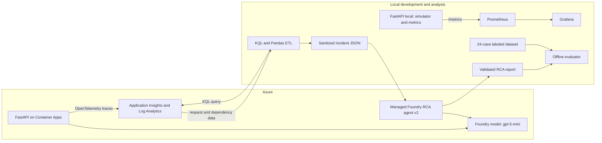
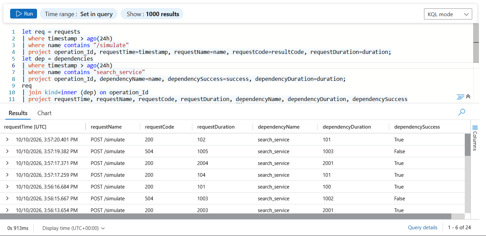

# Azure AIOps Incident RCA

This project follows an incident from a FastAPI request through its dependency
telemetry, then uses a Microsoft Foundry agent to explain what the evidence
shows. It includes a local incident simulator, Prometheus metrics for Grafana,
Azure Monitor extraction, and an offline evaluator for the agent's reports.

The FastAPI service can also send prompts to a Foundry model through `/ask`.
Tests and offline evaluation run without model calls. Live model evaluation and
Azure deployment are manual so usage stays under your control.

## Results

### Foundry RCA agent v2

| Measure | Result |
| --- | ---: |
| Diagnosis accuracy | 18/18 (100%) |
| Correct abstentions | 6/6 (100%) |
| Evidence claims grounded in telemetry | 153/153 (100%) |
| Schema validity | 24/24 (100%) |
| False diagnoses on insufficient evidence | 0/6 |
| Validator rejections | 0/24 |

These are results on the existing 24-case benchmark. The cases are familiar
development examples, so these scores do not establish performance on new
incidents or production reliability.

## Project status

| Component | Current state |
| --- | --- |
| FastAPI and Foundry | The API is deployed to Azure Container Apps. The `gpt-5-mini` model connection is verified. |
| Azure telemetry | OpenTelemetry requests and dependencies are verified in Application Insights. |
| Prometheus and Grafana | Run locally for development and dashboarding. |
| Incident ETL and RCA | KQL and Pandas ETL runs locally. The managed Foundry RCA agent analyzes the selected incident. |
| Automated checks | 93 tests and the offline RCA gate pass locally. |
| GitHub-hosted CI | The workflow is in the repository but disabled. |
| LLM judge | Implemented, not run. |

## Architecture



The Azure service sends traces to Application Insights. Prometheus and Grafana
monitor the local development service. The local ETL queries Azure Monitor,
prepares a sanitized incident record, and sends the approved telemetry to the
managed RCA agent. The offline evaluator scores reports against labeled cases.

## Application Insights incident trace

This query joins simulated HTTP requests to their dependency spans by
`operation_Id`. The results show `POST /simulate` requests that returned `504`
alongside failed `search_service` dependencies.



## Local development

For local development, set `APP_ENV=development` and
`ENABLE_SIMULATION=true` in `.env`. Keep Foundry and Application Insights
credentials there too. Git ignores this file, and `.dockerignore` keeps it out
of the Docker image.

Run the service with:

```powershell
uv run uvicorn app:app --reload
```

Development mode exposes `/docs`, `/metrics`, and `/simulate`. Local `/ask`
requests do not require an API key. Prompts can contain up to 2,000 characters,
and model responses are capped at 1,024 tokens.

## Production configuration

Production is the default unless `APP_ENV=development`. Set `AIOPS_API_KEY` to
a value with at least 32 characters, then send it to `/ask` in the
`X-API-Key` header. Production keeps `/health` available and disables `/docs`,
`/redoc`, `/openapi.json`, `/metrics`, and `/simulate`.

The API is deployed to Azure Container Apps with external HTTPS ingress on
port 8000, 0.25 vCPU, 0.5 GiB of memory, zero minimum replicas, and one maximum
replica. For a redeploy, set `APP_ENV=production` and
`ENABLE_SIMULATION=false`. Provide `FOUNDRY_ENDPOINT`, `FOUNDRY_MODEL`,
`FOUNDRY_API_KEY`, `AIOPS_API_KEY`, and
`APPLICATIONINSIGHTS_CONNECTION_STRING` through Container Apps configuration
and secrets. Do not upload `.env` or put credentials in the Docker image.

## Local Foundry root cause analysis

The RCA workflow uses a managed Foundry agent and your Azure identity through
`DefaultAzureCredential`. An Azure CLI sign-in is one way to provide that
identity. Install the local dependencies with
`uv sync --group etl --group rca`, then add these settings to the ignored
`.env` file:

```dotenv
FOUNDRY_PROJECT_ENDPOINT=https://<resource>.services.ai.azure.com/api/projects/<project>
FOUNDRY_AGENT_NAME=aiops-rca-agent
FOUNDRY_MODEL=gpt-5-mini
LOG_ANALYTICS_WORKSPACE_ID=<workspace-guid>
FOUNDRY_AGENT_VERSION=2
```

`FOUNDRY_PROJECT_ENDPOINT` points to the Foundry project used to create and run
the agent. It is separate from `FOUNDRY_ENDPOINT`, which the API uses for model
requests. The agent name and model have defaults, but the project endpoint is
required. Keep real endpoints and credentials out of tracked files. The ETL
and RCA dependency groups are optional and are not installed in the production
Docker image.

Extract the newest failed `/simulate` request, or select a request by its exact
operation ID. You can also select a successful request that had a slow
dependency:

```powershell
uv run --env-file .env --group etl python -m etl.extract_incidents
uv run --env-file .env --group etl python -m etl.extract_incidents --operation-id <operation-id>
```

The extractor writes `data/incidents/latest.json`. If the requested operation
ID is missing, it leaves the existing file untouched. `--env-file .env` loads
`LOG_ANALYTICS_WORKSPACE_ID` from your local configuration.

To create agent version 2 from the preserved version 1, run the creator once.
Then analyze the current local artifact:

```powershell
uv run --group rca python -m rca.create_agent
uv run --group rca python -m rca.analyze
```

The creator checks the remote version list and stops unless version 1 is the
only existing version. Do not run it for every incident. The analyzer calls the
named agent once and prints validated JSON. Model calls may incur Foundry
charges. Operation IDs, expected answers, and unknown metadata are left out of
the model input. Evidence must match exact `path=value` tokens from the input,
such as `dependency.success=false` or `dependency.name="search_service"`.
Unsupported evidence and malformed responses are rejected. A 404 without a
named dependency should produce `insufficient_evidence` with a null root cause.
Confidence is qualitative. The suggested checks are for investigation; the
workflow does not perform remediation.

## Local RCA evaluation

The evaluation dataset has 24 labeled cases: six dependency timeouts, six
application exceptions with exception evidence, six dependency latency
regressions with baselines, and six cases where the evidence is insufficient.
It includes sanitized telemetry from earlier 404 and 504 incidents, without
their operation IDs. The RCA agent receives only approved telemetry fields.
Expected labels are used for local scoring and the separately run judge. They
are not included in prediction requests.

Version 2 adds `root_cause_category` while version 1 keeps its original
response format. Before creating version 2, check the managed agent's version
list. `rca.create_agent` proceeds only when version 1 is the sole existing
version.

```powershell
uv run --group rca python -m rca.create_agent
```

Start with the 504 and 404 cases. The generator uses the selected agent version
and caches each response by case ID and version:

```powershell
uv run --group rca python -m evaluation.generate_predictions `
  --agent-version 2 `
  --case-id timeout-001 `
  --case-id abstain-001
```

Then run a five-case pilot covering all four categories. The two earlier cases
are reused from cache:

```powershell
uv run --group rca python -m evaluation.generate_predictions `
  --agent-version 2 `
  --case-id timeout-001 `
  --case-id abstain-001 `
  --case-id exception-001 `
  --case-id latency-001 `
  --case-id abstain-002
uv run --group rca python -m evaluation.score_predictions `
  --agent-version 2 `
  --case-id timeout-001 `
  --case-id abstain-001 `
  --case-id exception-001 `
  --case-id latency-001 `
  --case-id abstain-002
```

After reviewing the pilot, use `--all` to generate any remaining predictions.
Scoring runs locally, so you can repeat it without making more model calls:

```powershell
uv run --group rca python -m evaluation.generate_predictions --agent-version 2 --all
uv run --group rca python -m evaluation.score_predictions --agent-version 2
```

To get an LLM-as-a-Judge assessment, run its one-case command explicitly. This
makes a separate Foundry call and may incur charges:

```powershell
uv run --group rca python -m evaluation.judge --case-id timeout-001 --agent-version 2
```

Judge scores are not ground truth. Review any case where the judge and the
deterministic scorer disagree.

Predictions, judge results, reports, and local Azure fixtures stay under the
ignored `data/evaluations/` directory. The scorer reports category accuracy,
valid diagnosis coverage, abstention recall, false diagnosis rate, schema
validity, evidence grounding, and validator rejections. It also shows the
counts behind each score. The 24-case dataset is an engineering benchmark, not
a guarantee of production accuracy.

## Automated checks

The repository includes a GitHub Actions workflow that can run the tests,
compile the Python modules, score the offline RCA fixture, and build the Docker
image. It uses locked dependencies and placeholder settings. It needs no Azure
credentials and makes no Foundry calls. The workflow is currently disabled on
GitHub.

The eight-case fixture in `evaluation/fixtures/` contains synthetic incidents
and parsed reports from the earlier v2 evaluation. It has no raw model text or
operational IDs. The fixture checks the scorer and stored predictions. It does
not show how the live agent would perform after a prompt change. The separate
24-case dataset remains available for local evaluation.

Run the checks locally with:

```powershell
uv sync --locked --no-install-project --group dev --group etl --group rca
uv run --no-sync python -m pytest -q
uv run --group dev --group etl --group rca python -m evaluation.ci_gate
docker build -t aiops-fastapi:local .
```

Azure deployment and live Foundry evaluation are manual.
